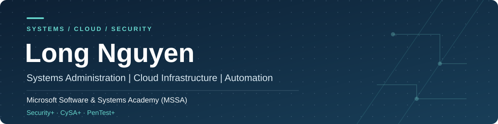
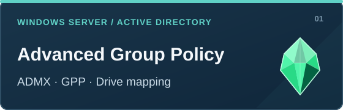
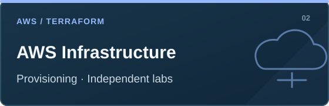
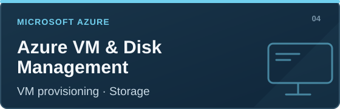
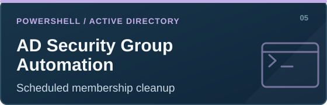
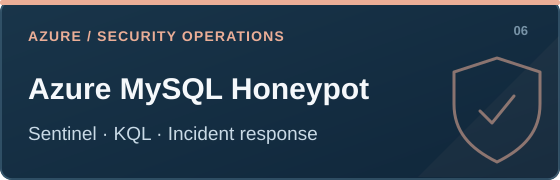

  <a href="https://www.linkedin.com/in/long-nguyen-b0b2b3138/">LinkedIn</a>

## About

Computer Science graduate and Air National Guard member with hands-on experience in Windows Server administration, cloud infrastructure, automation, and cybersecurity.

This portfolio brings together my work in systems configuration, cloud provisioning, scripting, troubleshooting, and security investigations.

**Technical focus:** `Windows Server` · `Active Directory` · `PowerShell` · `Azure` · `Microsoft 365` · `AWS` · `Terraform` · `Docker` · `KQL`

---

## Featured Projects

A selection of projects covering enterprise administration, cloud infrastructure, automation, and security investigations.

<table>
<tr>
<td width="50%" valign="top"></td>
<td width="50%" valign="top"></td>
</tr>
<tr>
<td valign="top"></td>
<td valign="top"></td>
</tr>
<tr>
<td valign="top"></td>
<td valign="top"></td>
</tr>
</table>

---

## All Projects

**15 projects · 6 technical categories**

Select a category to explore its projects and technical documentation.

<strong>01 · Cyber Range</strong> — 5 projects

Vulnerability management, threat hunting, endpoint security, and incident response.

- **[Vulnerability Management Program Implementation](https://github.com/AidenNguyenCyber/vulnerability-management-program)** — Developed a vulnerability management process in a simulated enterprise environment. Reduced scan findings from 23 to 3 through remediation and validation.
- **[Programmatic Vulnerability Remediations](https://github.com/AidenNguyenCyber/programmatic-vulnerability-remediations)** — Documented PowerShell and command-line fixes for Windows security configurations, including SMB signing and RDP authentication.
- **[Threat Hunting — Tor Browser Usage](https://github.com/legrado/threat-hunting-scenario-tor)** — Correlated Defender file, process, and network telemetry to investigate Tor Browser usage.
- **[Microsoft Defender Endpoint Compromise Investigation](https://github.com/AidenNguyenCyber/microsoft-defender-incident-investigation)** — Reconstructed a simulated compromise involving unauthorized authentication, remote execution, persistence, and command-and-control activity.
- **[Azure MySQL Honeypot Compromise Detection & Incident Response](https://github.com/AidenNguyenCyber/azure-mysql-honeypot-incident-response)** — Monitored and investigated a MySQL compromise using Azure, Sentinel, Defender, and database audit evidence.

<strong>02 · Active Directory & Windows Server</strong> — 2 projects

Group Policy and certificate infrastructure administration.

- **Advanced Group Policy** — ADMX templates, Group Policy Preferences, drive mapping, item-level targeting, and Folder Redirection.
- **PKI & Certificate Services** — Offline Root CA, Subordinate CA, certificate templates, enrollment, key recovery, and CRL/AIA configuration.

<strong>03 · PowerShell</strong> — 2 projects

Windows administrative scripting, reusable functions, and automation.

- **AD Security Group Maintenance Automation** — Scheduled cleanup of disabled user accounts from Active Directory security groups.
- **[Advanced Functions & Script Modules](https://github.com/AidenNguyenCyber/Az-040-Project)** — Get-CorpOSInfo, CIM, pipeline input, parameter validation, and modules.

<strong>04 · Azure & Microsoft 365</strong> — 2 projects

Cloud resources and Microsoft 365 administration with PowerShell.

- **Azure VM Deployment & Disk Management** — Virtual machine provisioning and disk management using PowerShell.
- **Microsoft 365 Administration with PowerShell** — Entra ID, Exchange Online, SharePoint, and Teams administration labs.

<strong>05 · Docker</strong> — 1 combined project, 5 labs

- **Docker Administration & Troubleshooting** — Docker Engine and Compose installation; Nginx deployment; container removal; encrypted file transfer and integrity validation; website outage troubleshooting.

<strong>06 · Terraform / AWS</strong> — 3 projects, 14 labs

Infrastructure as Code exercises, grouped by technical focus. Each lab represents a separate environment.

- **AWS Infrastructure Deployment** — KodeKloud Labs 2, 4, 7, 9, 35.
- **AWS Security & IAM** — KodeKloud Labs 13, 14, 16, 24, 27.
- **Terraform Automation & Monitoring** — KodeKloud Labs 11, 21, 25, 28.

